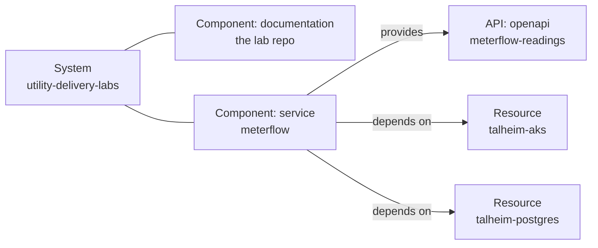

# Backstage template: utility platform delivery labs

A Backstage software template that creates the delivery lab repository on GitHub and registers it in your catalog.

## What running it does

1. Copies the lab content from `skeleton/` unchanged.
2. Renders `catalog-info.yaml` from `templated/` with your repository name and owner.
3. Creates the GitHub repository (public by default) and pushes everything as one commit on `main`.
4. Registers the catalog entities:



The API entity loads its definition from `apps/meterflow/api/openapi.yaml` in the new repository, so the API page in Backstage shows the real contract.

## Install

1. Copy this folder (`utility-delivery-labs/`) into the repository where you keep your Backstage templates.
2. Change two values in `template.yaml` if yours differ:
   - `spec.owner`: your user or group entity (currently `user:default/praveenbhatk8s`).
   - `allowedOwners` under `repoUrl`: GitHub accounts or organisations the repo may be created in.
3. Register the template, either in `app-config.yaml`:

   ```yaml
   catalog:
     locations:
       - type: url
         target: https://github.com/<you>/<templates-repo>/blob/main/utility-delivery-labs/template.yaml
         rules:
           - allow: [Template]
   ```

   or once through the UI: **Create → Register Existing Component** with the URL of `template.yaml`.

4. Open **Create**, choose **Utility platform delivery labs**, fill in the repository name, and run it.

## Requirements and gotchas

- **GitHub integration with write access.** `integrations.github` in `app-config.yaml` needs a token (or GitHub App) that can create repositories in the chosen owner.
- **The token needs the `workflow` scope.** The repository contains `.github/workflows/lab01-terraform.yml`. GitHub refuses to push workflow files from a token without `workflow` scope (or, for a GitHub App, without the *Workflows: write* permission). The publish step then fails with a permission error even though repo creation succeeded. If that happens, delete the empty repository, fix the token, and run the template again.
- **Scaffolder actions used:** `fetch:plain`, `fetch:template`, `publish:github`, `catalog:register`. All are in the default Backstage scaffolder backend with the GitHub module installed (`@backstage/plugin-scaffolder-backend-module-github` on the new backend system).
- **Why two fetch steps.** The lab content contains Helm templates (`{{ }}`) and GitHub Actions expressions (`${{ }}`). Running it through the template engine would break or empty them, so the content is copied with `fetch:plain` and only the catalog descriptor is templated.
- **Names in the catalog.** `meterflow`, `meterflow-readings`, `talheim-aks` and `talheim-postgres` are fixed names. Running the template twice into the same catalog creates conflicts; unregister the old entities first.
- **No TechDocs (yet).** The lab markdown lives next to the code it describes, which suits GitHub but not TechDocs' `docs/` layout. The repository component links to each lab on GitHub instead. Moving the docs into a TechDocs layout is a possible later step.

## Keeping it up to date

When new labs are added to the repository, refresh `skeleton/` from the latest copy (excluding `.git` and `PRIVATE-PREP.md`) and add a link for the new lab in `templated/catalog-info.yaml`.

## Talking about it in an interview

> I scaffold repositories through Backstage templates, so a new project comes with its catalog entries, API definition and ownership from the first commit. I published this lab repository that way: one template run created the GitHub repo and registered the service, its API and the infrastructure it depends on.
