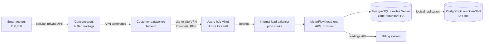

# Target architecture

Production runs on AKS in Azure Germany West Central across three availability zones. Disaster recovery runs on the customer's own OpenShift cluster in their Talheim datacentre. One portable MeterFlow deployment runs unchanged on both, and readings replicate continuously from Azure to the datacentre.

## Data path

Draw this first. Infrastructure exists to serve this path.

A reading's journey: the meter sends it over the private APN to a concentrator, which forwards it into the customer's datacentre. From there it crosses a site-to-site VPN into the Azure hub, passes the firewall, and reaches MeterFlow through an internal load balancer. MeterFlow validates it, stores it in PostgreSQL, and updates the completeness metrics. PostgreSQL replicates new readings to the DR database in the datacentre.

## Environments

| Environment | Where | Purpose | Shape | Runs |
| --- | --- | --- | --- | --- |
| dev | Azure | Delivery team builds and tests | 1 zone, small nodes, no database HA | Weekdays 07:00–19:00 |
| uat | Azure | Customer acceptance testing | Prod topology, small sizes | Weekdays, on demand |
| staging | Azure | Load tests and upgrade rehearsals | Prod-sized, 3 zones | Scheduled for test windows only |
| prod | Azure | Live meters | 3 zones, HA database, geo-redundant backup | Always |
| dr | Customer datacentre | Disaster recovery | OpenShift, warm database, head-end scaled to zero | Database always; head-end on failover |

All four Azure environments come from one Terraform codebase (lab 01). The DR site's hosts are prepared with Ansible (lab 07); MeterFlow is deployed there by the same GitOps setup as Azure (lab 04).

## Network

| Range | Use |
| --- | --- |
| 100.64.0.0/16 | Meter APN (customer and telecom provider) |
| 10.10.0.0/16 | Customer datacentre, including DR OpenShift on 10.10.20.0/24 |
| 10.40.0.0/22 | Azure hub: firewall, VPN gateway, DNS private resolver |
| 10.41.0.0/20 | dev spoke |
| 10.42.0.0/20 | uat spoke |
| 10.43.0.0/20 | staging spoke |
| 10.44.0.0/20 | prod spoke |
| 192.168.0.0/16 | AKS pod overlay (not routed outside the cluster) |
| 172.16.0.0/16 | AKS service range |

Each spoke /20 is split the same way, so every environment looks alike:

| Subnet | Prefix in prod | Size | Use |
| --- | --- | --- | --- |
| aks-nodes | 10.44.0.0/22 | 1,024 addresses | AKS node pools (pods use the overlay) |
| database | 10.44.4.0/24 | 256 | Delegated to PostgreSQL Flexible Server |
| private-endpoints | 10.44.5.0/24 | 256 | Key Vault, storage, container registry |
| internal-lb | 10.44.6.0/24 | 256 | Internal load balancer for meter and API traffic |

The Azure ranges were chosen to avoid every range the customer uses. Lab 01's Terraform refuses to plan if a spoke overlaps a customer range.

DNS: Azure private DNS zones resolve inside Azure. An Azure DNS Private Resolver has an inbound endpoint that the customer's DNS servers forward the Azure private zones to, and an outbound ruleset that forwards `stadtwerke-talheim.internal` to the customer's DNS. Without both directions, the DR cutover and the billing integration fail on name resolution.

## Security

- **No public endpoints.** AKS API server is private. PostgreSQL uses a delegated subnet with public access disabled. Key Vault and the container registry use private endpoints.
- **Identity.** People sign in through the customer's Entra ID; Kubernetes access uses Azure RBAC bound to customer groups. Workloads use workload identity, so no secrets for Azure access exist. PostgreSQL accepts Entra ID authentication only.
- **TLS.** All certificates are issued by cert-manager from an intermediate CA signed by the customer's corporate CA.
- **Pod security.** Every namespace enforces the Kubernetes `restricted` Pod Security Standard. The same images run under OpenShift's `restricted-v2` SCC without changes (ADR-002).
- **Network policy.** Default deny in every namespace; flows are allowed explicitly and match the connectivity matrix.
- **Egress.** All outbound traffic from Azure goes through Azure Firewall with an allow-list.

## Failure behaviour

| Failure | What happens | Recovery | Data impact |
| --- | --- | --- | --- |
| One AKS node fails | Pods reschedule; PDBs keep at least two head-end replicas | Automatic, minutes | None |
| One availability zone fails | Two zones carry the load; PostgreSQL fails over to its standby in another zone | Automatic, about 1–2 minutes for the database | None for committed readings |
| One VPN tunnel fails | BGP moves traffic to the second tunnel | Automatic, seconds | None |
| Both VPN tunnels fail | Readings buffer at concentrators | Restore VPN, or fail over to DR, which receives APN traffic locally | None while buffers last |
| Bad deployment | Argo Rollouts analysis fails and aborts the canary | Automatic rollback (lab 04) | None |
| Database corruption or bad migration | HA standby replicates the damage | Point-in-time restore (lab 05) | Up to the time of the restore point |
| Azure region unavailable | Head-end unreachable | Declare disaster; scale up DR head-end on OpenShift; point the APN route to DR | Readings received in the last replication lag; target 15 minutes |

The last row is why DR sits in the customer's datacentre: the APN already terminates there, so failing over means routing meter traffic a shorter distance, not a longer one.

## Decisions

See [adr/](adr/) for the reasoning behind each choice and the alternatives considered.
