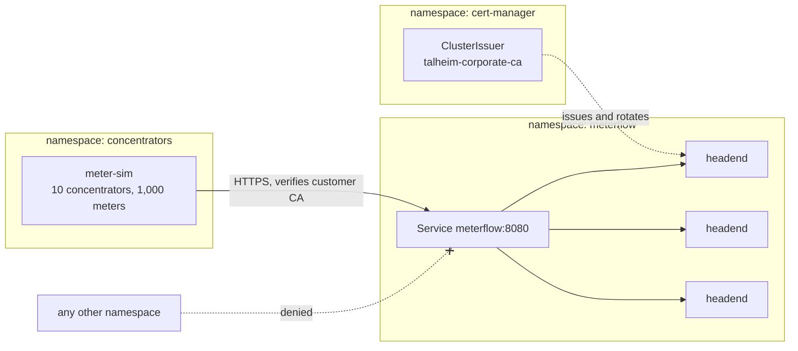

# Lab 02: Hardened, portable platform

MeterFlow running on Kubernetes the way a utility's security team would accept it: restricted pod security, an image that runs under any non-root UID (so it also runs on OpenShift), default-deny networking, TLS from the customer's own CA with automatic rotation, RBAC mapped to the customer's groups, and an acceptance script whose output goes straight into the handover pack.

It runs on a laptop (kind) or on a k3s cluster such as a Raspberry Pi.

## What you'll practise

- Kubernetes pod security and its OpenShift equivalent (SCCs).
- Building an image that survives a random UID.
- Default-deny NetworkPolicy owned by the platform, with app-specific allows owned by the chart.
- cert-manager with a customer CA, and rotating certificates without restarts.
- RBAC by customer group, and proving it with `kubectl auth can-i`.
- Producing acceptance evidence instead of saying "it works".

## Architecture of the lab



## Run it

Prerequisites: Docker (or OrbStack), kind 0.24+ (or k3s), kubectl, Helm 3, curl, openssl.

```bash
cd labs/02-hardened-platform
./scripts/00-cluster.sh       # kind cluster, zone labels, proves NetworkPolicy is enforced
./scripts/01-platform.sh      # cert-manager, customer CA issuer, namespaces, default-deny, RBAC
./scripts/02-deploy.sh        # build image, deploy chart, start simulated concentrators
sleep 40                      # let a few intervals pass
./scripts/03-acceptance.sh    # ten checks, report written to out/
```

On k3s: `export CLUSTER_TYPE=k3s` first. On any other cluster: `CLUSTER_TYPE=existing` and push the image to a registry it can pull from.

Time is compressed: one 15-minute meter interval passes every 10 seconds (`LAB_INTERVAL`).

## What the acceptance script proves

| # | Check | Requirement |
| --- | --- | --- |
| 1 | All replicas ready | HA |
| 2 | Replicas in more than one zone | Survive a zone failure |
| 3 | Non-root, read-only root FS, no privilege escalation | ADR-002 |
| 4 | A root pod is rejected by pod security admission | ADR-002 |
| 5 | The image runs as UID 1000680000, group 0 | ADR-002: OpenShift DR |
| 6 | An unauthorised namespace cannot reach the head-end | Default deny, connectivity matrix |
| 7 | TLS verifies against the customer CA for the service name | Customer requirement 6 |
| 8 | Certificate valid more than 30 days | Operability |
| 9 | 99.5% of readings acknowledged, none rejected | ADR-006 completeness SLO |
| 10 | Each customer group has exactly the intended access | Least privilege |

The report in `out/` is acceptance evidence: commit a copy to your handover pack (lab 10), not to the public repo.

## Who owns what

| Layer | Owner | Files |
| --- | --- | --- |
| Namespaces, pod security labels, default-deny, DNS allow | Platform | `manifests/namespaces.yaml`, `manifests/netpol-defaults.yaml` |
| Customer CA issuer | Platform, with the customer's PKI team | `manifests/corporate-ca.yaml` |
| Access for customer groups | Platform, approved by the customer | `manifests/rbac.yaml` |
| The workload, its allows, its certificate | Application chart | `chart/meterflow/` |

An application chart cannot remove the namespace's default-deny, because it doesn't own it. That separation is what lets a customer's security team approve the platform once and each application on its own.

## Exercises

1. **Watch the outage buffer.** Scale the head-end to zero for one minute: `kubectl -n meterflow scale deploy meterflow --replicas=0`. Watch `meter_sim_buffered_readings` grow (port-forward `deploy/meter-sim` 9091). Scale back to 3 and watch it drain. Explain why the customer can accept a four-hour RTO.
2. **Rolling update with no lost readings.** Change `meterflow.drainDelay` to `0s`, upgrade, and run `kubectl -n meterflow rollout restart deploy/meterflow` while watching `meter_sim_post_errors_total`. Then set it back to `5s` and repeat. Explain the difference.
3. **Rotate the certificate.** Run `kubectl -n meterflow delete secret meterflow-tls`. cert-manager reissues it. Check the head-end logs for `certificate loaded` with a new expiry, without any pod restarting.
4. **Zone failure.** Cordon and drain every node in one zone (`kubectl drain <node> --ignore-daemonsets`). Does the PodDisruptionBudget hold? Does completeness stay above 99.5%?
5. **OpenShift.** If you can run OpenShift Local (CRC, needs about 10 GB of RAM) or have access to a cluster, deploy the chart with `--set expose.type=route`. Two things will differ: there is no `busybox` root-pod test needed, because the SCC assigns a UID; and the DNS egress rule in the chart's NetworkPolicy targets `k8s-app: kube-dns` on port 53, while OpenShift's DNS pods run in `openshift-dns` and listen on 5353. Fix the policy with a value, not a fork.
6. **Break the contract.** Add `runAsUser: 0` to the chart's pod security context and upgrade. Read the exact error. This is lab 09 drill 1 in miniature.

## Done when

- `03-acceptance.sh` passes all ten checks.
- You've done exercises 1, 2 and 3, and can explain each result in one sentence.
- You can give the [TALK.md](TALK.md) walkthrough in two minutes.
